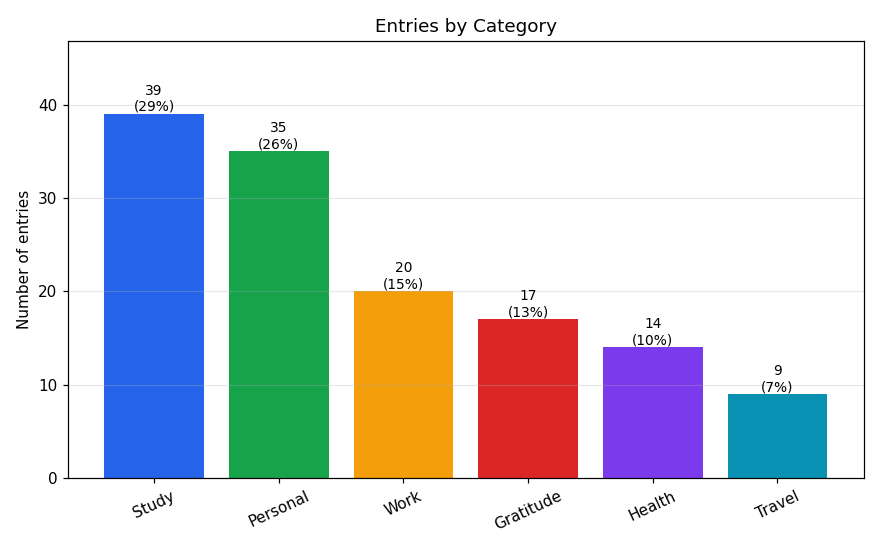
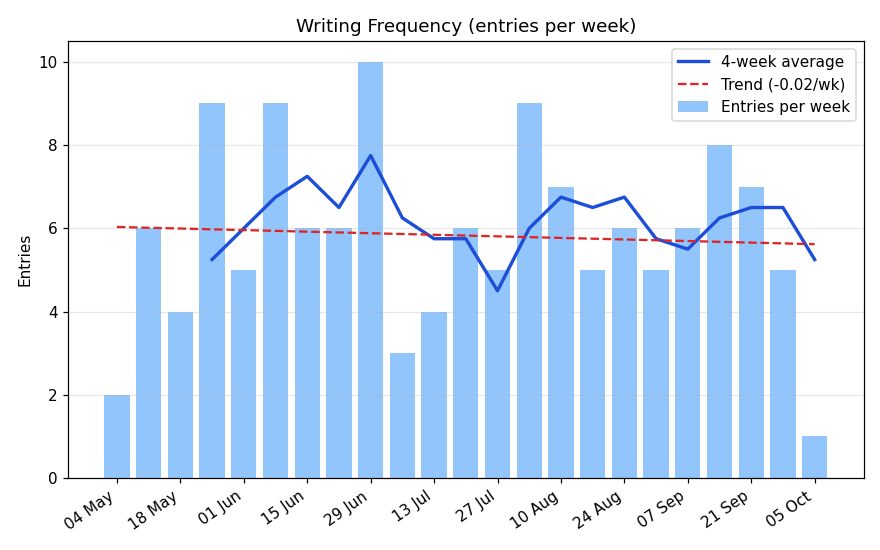
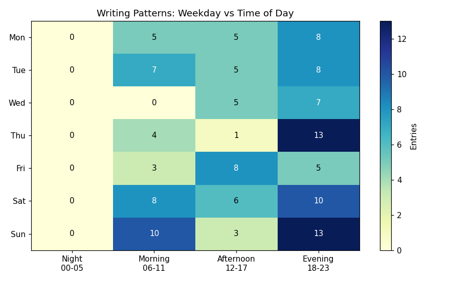
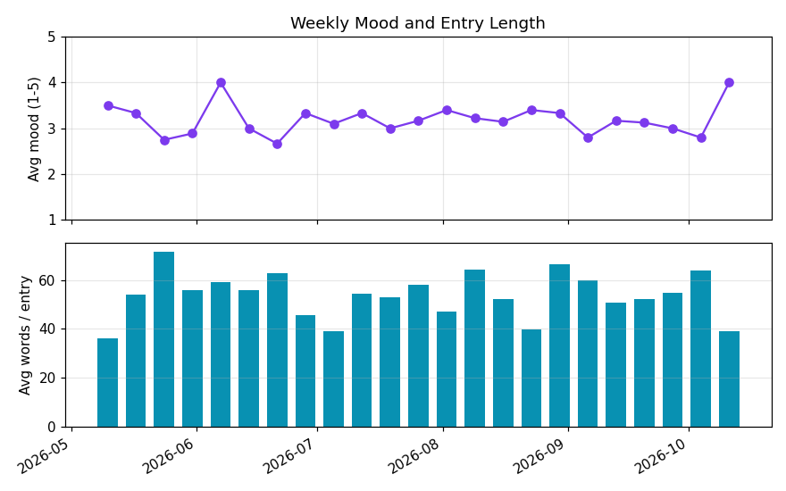

# Journal Analytics

A desktop application that stores journal-entry **metadata** (date, time, category, title, mood, word count)
and turns it into useful **activity analysis** - so you can understand your writing frequency and patterns
without re-reading every entry.

Built with **Python, Tkinter, Pandas, NumPy and Matplotlib**.

| Domain | Problem solved |
|---|---|
| Productivity | Understand writing frequency and patterns without reading every entry manually |

## Features

- **Manage entries** - add, edit, delete; all data is saved automatically to `data/journal.json`
- **Search / filter** - by keyword, category and date range; click table headers to sort
- **Counts & frequency** - totals, entries per week, active-day ratio, streaks, longest break
- **Compare** - categories (entries, share %, avg words, avg mood) and any two date periods side by side
- **Pattern detection** - favourite weekday and time of day, weekend share, top category, trend (NumPy regression), mood vs. entry length
- **5 Matplotlib reports** (embedded in the GUI, exportable as PNG)
- **CSV import / export**, demo-data generator, input validation and defensive error handling

## Screenshots (generated from demo data)

| | |
|---|---|
|  |  |
|  |  |

## Run it

```bash
git clone <your-repo-url>
cd journal-analytics
python -m venv .venv
.venv\Scripts\activate          # Windows   (Linux/macOS: source .venv/bin/activate)
pip install -r requirements.txt
python main.py
```

Tkinter ships with Python (Linux only: `sudo apt install python3-tk`).
Tip: use **File > Load demo data** to see the analytics straight away.

## Run the tests

```bash
python -m unittest discover -s tests -v
```

## Project structure

```
journal-analytics/
├── main.py                 # entry point
├── journal/
│   ├── validators.py       # input validation + ValidationError
│   ├── models.py           # Entry dataclass, build_entry() factory
│   ├── storage.py          # JSON persistence (atomic writes), CSV import/export
│   ├── analytics.py        # Pandas/NumPy analysis (no GUI code)
│   ├── visuals.py          # Matplotlib chart builders
│   ├── sample_data.py      # reproducible demo-data generator
│   └── gui.py              # Tkinter interface (Entries / Analytics / Charts tabs)
├── tests/                  # 33 unit tests (validators, storage, analytics, charts)
├── docs/screenshots/       # charts rendered by make_screenshots.py
└── data/                   # journal.json is created here at runtime
```

## How the requirements are met

| Requirement | Where |
|---|---|
| Python functions and data structures | dataclass `Entry`, lists, dicts, tuples, Series/DataFrames throughout |
| File handling for persistent storage | `storage.py` - JSON (atomic write, corruption backup) and CSV |
| Minimum 3 user-defined modules | `validators`, `models`, `storage`, `analytics`, `visuals`, `sample_data`, `gui` |
| Array / NumPy / Pandas | `analytics.py` - `groupby`, `resample`/periods, `np.diff` streaks, `np.polyfit` trend, `np.add.at` heatmap matrix |
| Tkinter GUI | `gui.py` - Notebook with 3 tabs, Treeview, forms, menus, dialogs |
| At least 2 Matplotlib visualizations | `visuals.py` - 5 reports |
| Input validation | `validators.py`, used by `build_entry` and the filter/period inputs |
| Exception handling | `ValidationError`, `StorageError`, try/except around all I/O and charts |
| Documentation / testing | docstrings, this README, `tests/` |

## Design notes

- **Separation of concerns:** `analytics.py` and `visuals.py` know nothing about Tkinter, which is why they can be unit-tested headlessly.
- **Charts use `Figure`, not `pyplot`**, so they embed cleanly in Tkinter and can also be rendered without a display.
- **Safe saving:** data is written to a temp file and swapped in with `os.replace`, so a crash mid-save cannot corrupt the journal.
- **Streak logic:** unique dates -> `np.diff` -> split where the gap isn't 1 day -> run lengths.

## Possible future work

Tag support, word-frequency / sentiment analysis of entry text, goal setting ("write 4x per week"), password protection, packaging as an `.exe` with PyInstaller.
